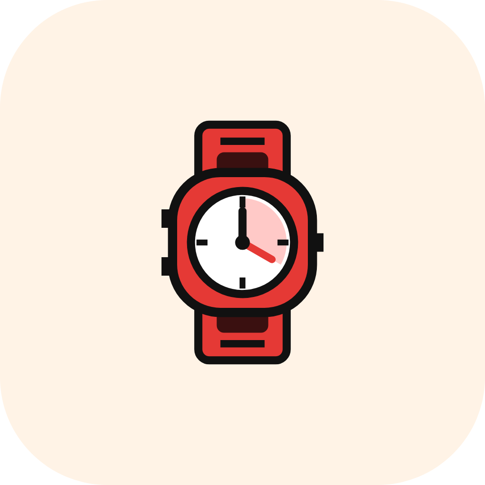
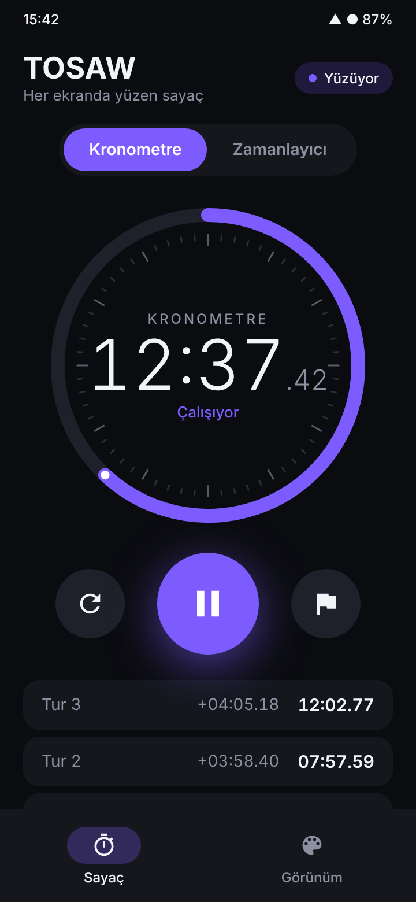
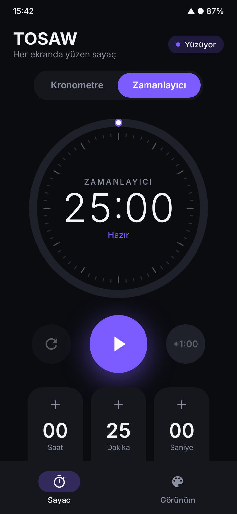
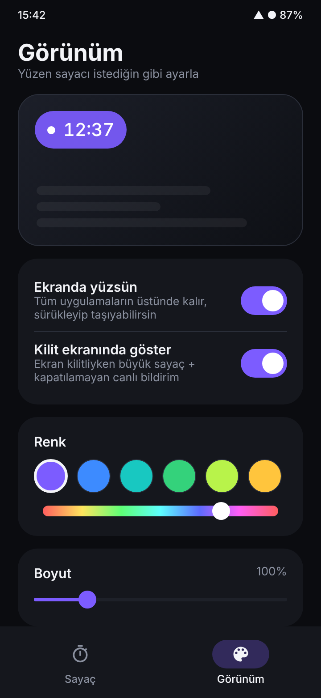
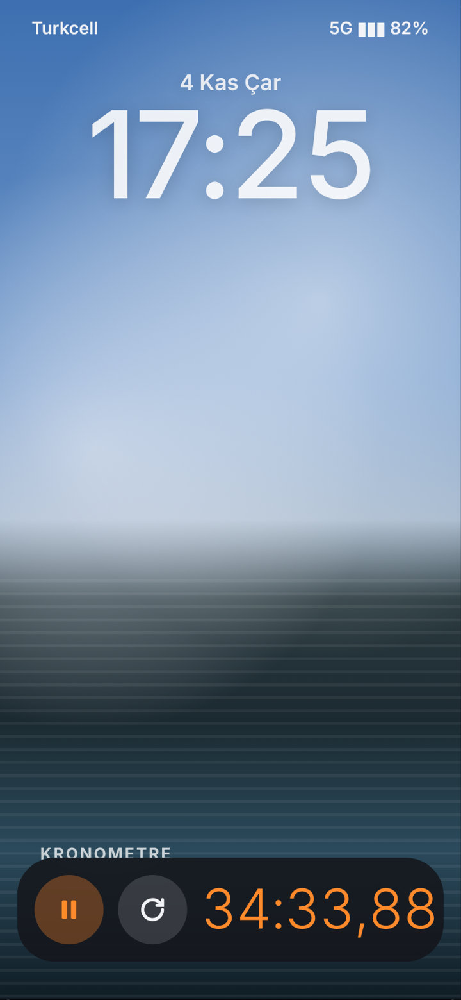
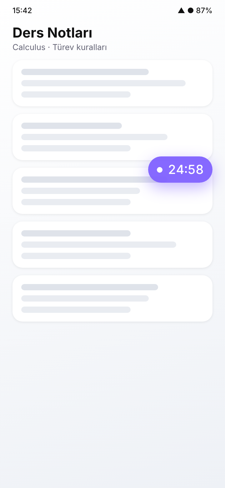

<p align="center"></p>

<h1 align="center">TOSAW</h1>

<p align="center">A floating stopwatch & countdown timer for Android that stays on top of every app and on your lock screen.</p>

<p align="center">
  
  
  
  
  
</p>

## Features

- **Floating window** – a small timer pill that floats over all apps. Tap to start/pause, double-tap to open the app, drag to move, pinch to resize.
- **Always on** – runs as a foreground service, so it keeps going even when the app is closed.
- **Lock screen widget** – an iPhone-style widget at the bottom of the lock screen with pause and reset buttons, plus a non-dismissible live notification with the same controls.
- **Two modes** – stopwatch with laps, and countdown timer with presets and a +1 min button.
- **Customizable** – 11 preset colors, a custom hue slider, size (60–250%) and opacity controls.
- **Alarm** – sound, vibration and a flashing red window when the timer ends.

## Tech Stack

Kotlin · Jetpack Compose · Material 3 · Foreground Service · `WindowManager` overlay · StateFlow  
Min SDK 26 (Android 8.0) · Target SDK 35

## Getting Started

**Download the APK:** open the *Actions* tab → latest **Build APK** run → download `TOSAW-apk` from *Artifacts*.

**Build it yourself:** open the project in Android Studio and press ▶ Run, or:

```bash
./gradlew assembleRelease
```

## Permissions

| Permission | Used for |
|---|---|
| Display over other apps | Floating timer window |
| Notifications (Android 13+) | Live timer on the lock screen |
| Foreground service | Keeping the timer running in the background |

> **Xiaomi / MIUI / HyperOS:** also enable *"Show on lock screen"* and *"Display pop-up windows while running in the background"* under App info → Other permissions.

## Notes

- Android only — iOS doesn't allow apps to float over other apps.
- Screenshots are UI design previews.

---
Made by [muba14](https://github.com/muba14)
